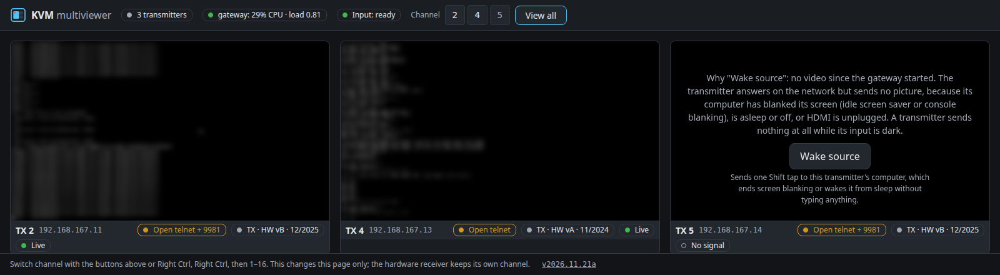
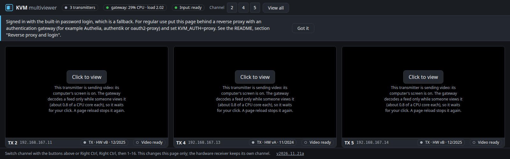
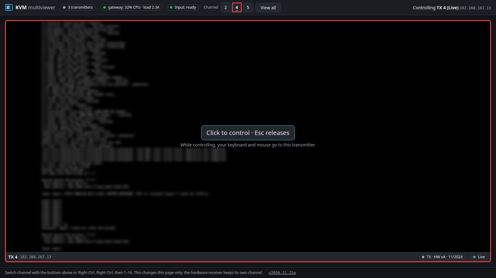
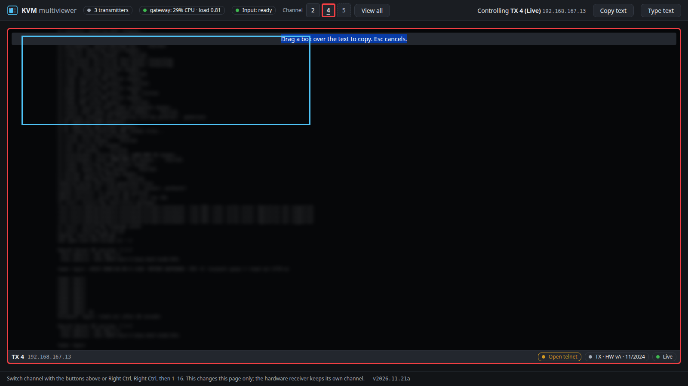
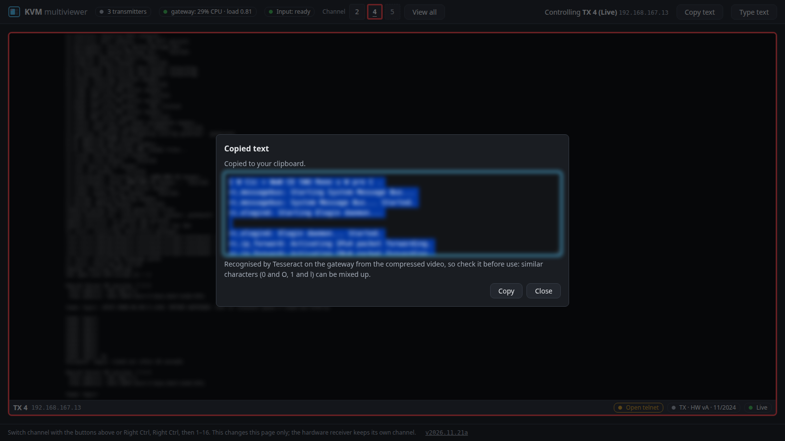
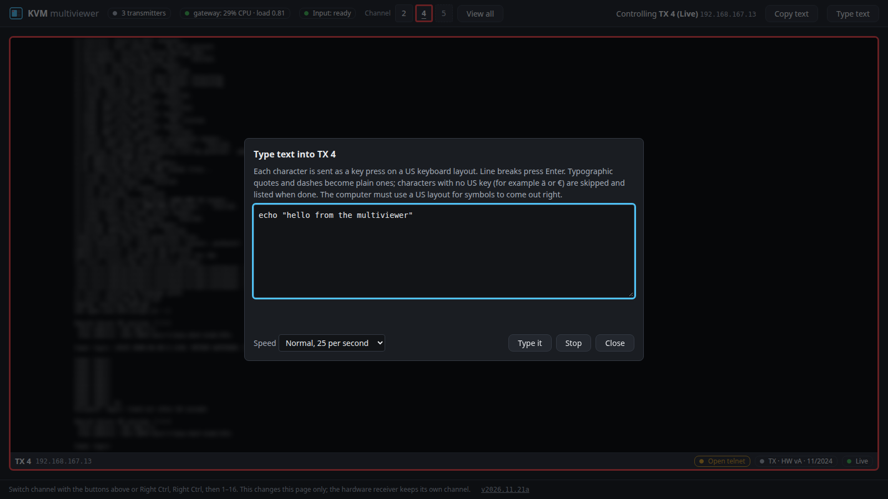

# AV-over-IP multiviewer

A browser multiviewer and [KVM](https://en.wikipedia.org/wiki/KVM_switch) for the
**TESmart HKE120-EH23** HDMI-over-IP extender (sold earlier as HKE12MMA20). One small server on
the extenders' network shows every transmitter on one page, and lets you take keyboard and
mouse control of any of them from a browser. No hardware receiver is needed.



*Screen contents are blurred in all screenshots because they show real server consoles.*

> **Security warning: every HKE120-EH23 unit (transmitters and receiver) accepts telnet logins
> as `root` with no password.** Anyone who can reach the extenders' network can take over a unit.
> Keep the extenders on their own VLAN. See [Security](#security). The page marks each affected
> transmitter with an **Open telnet** chip.

Not affiliated with TESmart. The extender's protocol was worked out by observing our own units
on our own network; see [docs/firmware-internals.md](docs/firmware-internals.md).

## What it does

- **Finds every transmitter** (ID 1–16) on its own, including ones whose computer is asleep.
- **Shows each one in the browser** over [WebRTC](https://en.wikipedia.org/wiki/WebRTC) with low
  delay. Each feed is converted only while someone is viewing it.
- **Keyboard and mouse control** of the transmitter you select, sent the same way the hardware
  receiver sends it. The hardware receiver can stay on another channel.
- **Copy text** from the screen: drag a box over the picture, the text is recognised on the
  gateway and put on your clipboard, like PiKVM's OCR.
- **Type text**: paste text and have it typed into the computer as keystrokes.
- **Wake source**: one Shift tap to a transmitter whose computer has blanked its screen or is asleep.
- **Unit details** per tile: role, hardware variant, firmware build, uptime, CPU and memory, read
  from the unit.
- **Login on by default**, designed to sit behind a
  [reverse proxy](https://en.wikipedia.org/wiki/Reverse_proxy) with an authentication gateway, under
  any URL path.

Not done yet: audio in the browser (the transmitters send it; the gateway does not convert it),
infrared sending (placeholder only, see [Infrared](#infrared-placeholder)), and changing a
transmitter's own ID from the page.

## Screens and states

Each tile says why it looks the way it does. A tile is in one of these states:

| Tile shows | Status chip | Why | What to do |
|---|---|---|---|
| **Click to view** | Video ready | The transmitter is sending video (its computer's screen is on). The gateway converts a feed only while someone views it, because each one costs about 0.8 of a CPU core. | Click the tile, or **View all**. |
| Picture | Live | The feed is running and playing. | Click the picture to control it. |
| Text, then picture | Connecting / Starting feed | The gateway is starting the conversion; the first picture takes a few seconds. | Wait. |
| **Wake source** | No signal | The transmitter answers on the network but sends **no video at all**: its computer has blanked its screen (screen saver or console blanking), is asleep or off, or HDMI is unplugged. A transmitter with a dark input sends nothing, so there is no picture to show. | Click **Wake source** (one Shift tap). Video returns within about 10 s if the screen was only blanked or asleep. |
| Message only | No signal | The transmitter does not answer on the network: no power or no cable. | Check the unit. |
| **Open telnet** chip (orange) | any | The unit lets anyone log in as root without a password; **Open telnet + 9981** also has the open file-write service. Click the chip for details. | See [Security](#security). |
| Picture with warning | Degraded | Frames arrived incomplete (lost on the network), so the picture may garble until the next keyframe. | See [Network](#network). |

Before clicking (a fresh page shows every transmitter that sends video like this; the notice at
the top appears while the built-in login is in use):



Controlling one transmitter. Click the picture to capture keyboard and mouse; **Esc** releases them.
**Copy text** and **Type text** sit next to the transmitter's name in the header.



The header has the transmitter count, the gateway's CPU load, the input connection state, and
the **channel bar**: one button per transmitter, then **View all**. **View all** shows every
transmitter and starts every feed that has a picture; while you control one, it also ends control.
The same hotkey as the hardware receiver works on the page: **Right Ctrl, Right Ctrl, then 1–9**
(or 1 then 0–6 for 10–16). It switches this page only; the hardware receiver keeps its own channel.
The footer shows the version; it links to this repository.

## Copy text and type text

**Copy text** (OCR, [optical character recognition](https://en.wikipedia.org/wiki/Optical_character_recognition)):
in control view, click **Copy text** and drag a box over the text. The browser cuts that box out
of the current video frame, enlarges it, turns it dark-on-light, and sends it to the gateway, which
reads it with [Tesseract](https://github.com/tesseract-ocr/tesseract) on the gateway itself (the idea
comes from [PiKVM](https://github.com/pikvm/pikvm), see [Thanks](#thanks)); no
cloud service sees it, and nothing is read until you ask. The text opens in a box where you can
edit it, and is copied to your clipboard. Browsers allow automatic copying only on HTTPS pages (or
localhost); on plain HTTP the text is selected for you to press Ctrl+C. The video is compressed,
so check the result: look-alike characters (0 and O, 1 and l) can be mixed up. Other languages:
add the Debian `tesseract-ocr-<lang>` package to the image and set `OCR_LANG` (ex. `eng+fin`).

**Type text**: click **Type text**, paste the text, and click **Type it**. The gateway sends each
character as a key press and release on a **US keyboard layout**, 25 characters per second by
default (`TYPE_GAP_MS`, 20 ms per report); the dialog offers slower speeds for computers that drop
fast keys. Line breaks press Enter, typographic quotes and dashes become plain ones, and
characters without a US key (ex. `ä`, `€`) are skipped and listed afterwards. At most 20 000
characters are typed per request. The computer must use a US layout, or symbols come out as that layout's keys. **Stop**,
switching channel, pressing keys on the controlled computer yourself, or closing the page stops
the typing. Only one page at a time can type into a transmitter.







## How transmitters are found and shown

The gateway uses two independent signals:

1. **Video.** Every transmitter sends its picture as
   [IP multicast](https://en.wikipedia.org/wiki/IP_multicast) to group 239.1.1.1, UDP port
   4399 + ID (4400–4415). The gateway joins all 16 ports and lists a transmitter as soon as a
   packet arrives.
2. **Presence.** A transmitter whose computer is asleep sends no packets, so video alone would
   hide it. Every 5 s the gateway sends one UDP byte to port 9 of each transmitter address
   (192.168.167.10–25). A unit that is up answers with an ICMP "port unreachable", which marks it
   present. Nothing on the unit is contacted beyond that.

A transmitter appears on the page within about 5 s of either signal and stays listed until the
gateway restarts. Its tile then reports what it is doing (see the table above). The hardware
receiver (192.168.167.90) is not listed. Unit details are read every 30 s over the unit's telnet
port, read-only.

With no visible page for `IDLE_SECS` (default 120 s) the gateway stops every feed and leaves the
multicast groups. The next page visit starts it again and finds everything within about 5 s.
A tab in the background does not count as a viewer, so a forgotten tab does not keep the feeds
running, and a feed stops 30 s after its last viewer leaves.

## Requirements

**Hardware**
- One or more TESmart HKE120-EH23 transmitters (IDs 1–16). Tested on 3 transmitters made 11/2024
  and 12/2025, with one receiver.
- A Linux x86-64 host with one network port on the extenders' network (see [Network](#network)).
- An **Intel GPU with VAAPI H.264 encoding** (`/dev/dri/renderD128`). Browsers cannot play the
  extender's [HEVC](https://en.wikipedia.org/wiki/High_Efficiency_Video_Coding) over WebRTC, so each
  feed is re-encoded to [H.264](https://en.wikipedia.org/wiki/Advanced_Video_Coding) with
  [VAAPI](https://en.wikipedia.org/wiki/Video_Acceleration_API). Tested on Intel HD 4600 (Haswell,
  i965 driver); newer Intel uses the iHD driver, which the image also contains. AMD and NVIDIA are
  untested.

**Software** (all inside the containers)
- Docker with Compose v2.
- [mediamtx](https://github.com/bluenviron/mediamtx) 1.21.4: the WebRTC server.
- Debian 13 packages: ffmpeg (HEVC decoding, H.264 VAAPI encoding), Python 3.13, aiohttp, PyJWT and
  cryptography (signed-token login), iproute2 and ethtool.

**Resources** (measured 2026-11-20 and 2026-11-21 on an Intel i7-4700MQ, 4 cores from 2013)

| | CPU | Memory |
|---|---|---|
| Each feed being viewed (software HEVC decoding, GPU encoding) | 0.6–0.8 of a core | about 100 MB |
| Gateway with nobody viewing | about 3 % of a core | about 40 MB |
| mediamtx | about 1–2 % of a core | about 60 MB |
| Images on disk | | about 850 MB (gateway) + 90 MB (mediamtx) |

Network load per transmitter: 0.46 Mbit/s measured for a mostly static text console. A busy
desktop or video sends much more; that was not measured. Keyframes arrive as bursts of about 110
packets, which is why the container raises the network card's receive ring to 4096.

## Network

The extenders use a fixed network: transmitters at 192.168.167.(9 + ID), the receiver at
192.168.167.90, all in 192.168.167.0/24. This cannot be changed. The gateway needs:

- **The same network segment as the extenders.** Its port must be in the same
  [VLAN](https://en.wikipedia.org/wiki/VLAN) /
  [broadcast domain](https://en.wikipedia.org/wiki/Broadcast_domain) as the transmitters, because
  they are found by multicast and [ARP](https://en.wikipedia.org/wiki/Address_Resolution_Protocol),
  and neither crosses a router. The container adds the address 192.168.167.3 (`HID_IP`) to that
  port, as the source of keyboard and mouse packets.
- **Multicast must reach the gateway.** The extender's manual asks for
  [IGMP snooping](https://en.wikipedia.org/wiki/IGMP_snooping) to be off, so switches flood the
  multicast to every port. If snooping stays on, the VLAN needs an active
  [IGMP](https://en.wikipedia.org/wiki/Internet_Group_Management_Protocol) querier, or the
  switch stops forwarding the groups the gateway joins. Tested with snooping off.
- **A dedicated VLAN is strongly advised.** With snooping off, every transmitter's video goes to
  every port of the VLAN, and the units accept passwordless root telnet logins from anything on
  that network.
- **Host firewall:** allow incoming multicast UDP 4400–4415, incoming ICMP "port unreachable"
  from the transmitters (presence check), TCP 8820 (the page), and UDP 8189 (video to browsers).
- **Browsers get the video directly from the host** over WebRTC on UDP 8189
  ([ICE](https://en.wikipedia.org/wiki/Interactive_Connectivity_Establishment)), not through the
  reverse proxy: only the page, the signalling and the keyboard/mouse
  [WebSocket](https://en.wikipedia.org/wiki/WebSocket) pass the proxy. Browsers behind
  [NAT](https://en.wikipedia.org/wiki/Network_address_translation) or a VPN need
  `WEBRTC_ADDITIONAL_HOSTS` (an address they can reach) and, if UDP is blocked,
  `WEBRTC_TCP_ADDRESS`.
- **Broadcasts:** only ARP. Neither the extenders nor the gateway use broadcast discovery.

Packet loss shows up as "Degraded" tiles and broken frame counts. The usual causes are a small
receive ring on the gateway's network card and busy switch ports.

## Install

```sh
git clone https://github.com/luuvasara/avoip-multiviewer.git
cd avoip-multiviewer
cp deploy/.env.example deploy/.env      # set NIC at least
docker compose -f deploy/compose.yaml up -d --build
docker compose -f deploy/compose.yaml logs kvm | grep login   # the generated password
```

Open `http://<host>:8820/` and sign in as `kvm` with the password from the log. It is kept in the
state volume, so it survives restarts. Set `KVM_PASS` to choose your own.

## Configuration

Everything is set in `deploy/.env`; [deploy/.env.example](deploy/.env.example) lists every
setting with an example.

| Setting | Default | What it does |
|---|---|---|
| `NIC` | (required) | Network port that reaches the extenders, ex. `enp3s0` |
| `HID_IP` | `192.168.167.3` | Address added on `NIC` as the keyboard/mouse source; must be unused |
| `LISTEN` | `0.0.0.0:8820` | Page address; `127.0.0.1:8820` when the proxy runs on the same host |
| `HOST_NAME` | `gateway` | Name of this host in the page header |
| `OCR_LANG` | `eng` | Tesseract language(s) for Copy text, ex. `eng+fin` (install the language pack) |
| `TYPE_GAP_MS` | `20` | Pause after each key report when typing text; raise it if characters go missing |
| `IDLE_SECS` | `120` | Stop everything after this long with no visible page; `0` = never |
| `RENDER_DEVICE` | `/dev/dri/renderD128` | GPU used for encoding |
| `LIBVA_DRIVER_NAME` | libva chooses | `i965` (Intel up to 9th gen) or `iHD` (newer) |
| `KVM_AUTH` | `basic` | `basic`, `proxy` or `none`, see below |
| `KVM_USER`, `KVM_PASS` | `kvm`, generated | Built-in login |
| `KVM_TOKENS` | none | Bearer tokens for scripts, comma-separated |
| `TRUSTED_PROXIES` | `127.0.0.1/32,::1/128` | Proxies allowed to send forwarded and identity headers |
| `AUTH_USER_HEADER` | auto | Header with the signed-in user, ex. `Remote-User` |
| `AUTH_ALLOWED_USERS` | anyone | Users let in, comma-separated, ex. `alice@example.com` |
| `AUTH_JWKS_URL`, `AUTH_JWT_AUDIENCE`, `AUTH_JWT_ISSUER`, `AUTH_JWT_HEADER` | none | Verify a signed token from the proxy instead of trusting its address |
| `BASE_PATH` | none | Path prefix when the proxy does not strip it, ex. `/kvm` |
| `ALLOWED_ORIGINS` | the page's own | Extra origins allowed to send keyboard and mouse |
| `WEBRTC_UDP_PORT`, `WEBRTC_TCP_ADDRESS`, `WEBRTC_ADDITIONAL_HOSTS` | `8189`, off, none | Video transport to browsers |
| `PUBLISH_BASE`, `STREAM_STATE_URL` | off | Copy each feed to another RTSP server as `<base>/tx<n>`, optionally only while a state URL reports `{"air": true}` |

## Reverse proxy and login

**The page gives full keyboard control of every connected computer. Do not expose it without a
login.** Login is on by default:

| `KVM_AUTH` | Who gets in | Use it for |
|---|---|---|
| `basic` (default) | Anyone with the password ([HTTP Basic](https://en.wikipedia.org/wiki/Basic_access_authentication)). Without `KVM_PASS` a password is generated on first start and printed in the log. | First start and testing. It is a fallback: one shared password, no logout, no two-factor. The page says so. |
| `proxy` | Users your reverse proxy's authentication gateway has signed in ([Authelia](https://www.authelia.com/), [authentik](https://goauthentik.io/), [oauth2-proxy](https://oauth2-proxy.github.io/oauth2-proxy/), [Pomerium](https://www.pomerium.com/), [Cloudflare Access](https://developers.cloudflare.com/cloudflare-one/policies/access/), [Tailscale Serve](https://tailscale.com/kb/1312/serve)) | Regular use. |
| `none` | Everyone who can reach the port | Only an isolated, trusted network. The page shows a warning. |

In `proxy` mode the gateway takes the user from the first of these headers that the proxy sets:
`Remote-User`, `X-Remote-User`, `X-Forwarded-User`, `X-Auth-Request-User`,
`X-Auth-Request-Email`, `X-Forwarded-Email`, `X-Authentik-Username`, `X-Pomerium-Claim-Email`,
`Tailscale-User-Login`, `Cf-Access-Authenticated-User-Email` (or only `AUTH_USER_HEADER`).
It accepts them **only from `TRUSTED_PROXIES`**; any other client gets 403, even with the header,
so nobody can skip the proxy by connecting to the port directly. With `AUTH_JWKS_URL` set, it
instead checks the proxy's signed [JWT](https://en.wikipedia.org/wiki/JSON_Web_Token) (signature,
expiry, audience, issuer), which also works when the proxy is on another host.

In every mode:
- `/healthz` answers without a login, for health checks; it reveals nothing.
- `KVM_TOKENS` lets scripts in with `Authorization: Bearer <token>`.
- The keyboard/mouse WebSocket accepts only the page's own origin, so another web site open in the
  same browser cannot type into your computers.
- From a trusted proxy, `X-Forwarded-For`, `X-Forwarded-Proto`, `X-Forwarded-Host`,
  `X-Forwarded-Prefix` and [`Forwarded`](https://www.rfc-editor.org/rfc/rfc7239) are honoured
  (client address in the log, origin check, redirects).
- The video server's own HTTP port listens on 127.0.0.1 only; the gateway relays its
  [WHEP](https://datatracker.ietf.org/doc/draft-ietf-wish-whep/) signalling, so video sits behind
  the same login as the page.

**Paths.** The page uses relative URLs, so it works at the root of a host
(`https://kvm.example.com/`) or under a path (`https://example.com/kvm/`). If the proxy strips the
path before forwarding, nothing needs setting. If it forwards `/kvm/...` unchanged, set
`BASE_PATH=/kvm`. Both were tested through Caddy: page, live video and the keyboard/mouse connection.

Caddy with Authelia, own host name:

```caddy
kvm.example.com {
	forward_auth authelia:9091 {
		uri /api/authz/forward-auth
		copy_headers Remote-User Remote-Groups Remote-Email Remote-Name
	}
	reverse_proxy 127.0.0.1:8820
}
```

nginx with oauth2-proxy, under `/kvm/` (the oauth2-proxy `location /oauth2/` blocks are as in its
documentation):

```nginx
location /kvm/ {
    auth_request /oauth2/auth;
    error_page 401 = /oauth2/sign_in;
    auth_request_set $email $upstream_http_x_auth_request_email;   # needs --set-xauthrequest
    proxy_set_header X-Forwarded-Email $email;
    proxy_pass http://127.0.0.1:8820/;          # the trailing / strips /kvm
    proxy_http_version 1.1;                     # WebSocket for keyboard and mouse
    proxy_set_header Upgrade $http_upgrade;
    proxy_set_header Connection "upgrade";
    proxy_set_header Host $host;
    proxy_set_header X-Forwarded-Proto $scheme;
    proxy_set_header X-Forwarded-For $proxy_add_x_forwarded_for;
}
```

With either, set `KVM_AUTH=proxy` and `LISTEN=127.0.0.1:8820`.

## Infrared (placeholder)

The extender passes infrared one way, from an IR receiver cable on the hardware receiver to an IR
emitter cable on the transmitter. The goal is to send IR from the page to the device next to a
transmitter (a TV box, a projector), without any IR reader, using the public code databases:
[irdb](https://github.com/probonopd/irdb) lists most remotes by protocol, device and function, and
[IrpTransmogrifier](https://github.com/bengtmartensson/IrpTransmogrifier) renders those to raw
timings or Pronto Hex. [`rx/ir.py`](rx/ir.py) already turns NEC codes and Pronto Hex into raw
timings. Sending is not implemented: the network format of IR messages has not been captured yet,
and `rx/ir.py` explains how to capture it. See also
[consumer IR](https://en.wikipedia.org/wiki/Consumer_IR).

## Security

- **Open root telnet on the units.** Every transmitter and the receiver answer telnet on TCP port
  23 and log in `root` with no password (checked on all four units here, 2026-11-20). Anyone who
  can reach the extenders' network can change a unit's ID and settings, replace its firmware, or
  watch and inject video, keyboard and mouse traffic. There is no documented way to turn it off.
  The gateway logs in this way, read-only, to show the unit details; a successful login is what
  makes the page show the **Open telnet** chip on that transmitter.
- **Open root file-write service on newer units.** Units with the factory update service
  (`trans`, seen on the 12/2025 transmitters and on the receiver, shown as hardware variant **vB**)
  also listen on TCP port 9981. Its code, read from the binary, takes a file name and data from
  anyone who connects, kills processes of that name and writes the file as root. It was not
  exercised here, because using it is a write to the unit. The **Open telnet** chip on a vB unit
  says so.
- **No authentication on the extender protocol.** Video is multicast in the clear, and a
  transmitter accepts keyboard and mouse packets from any address, with no receiver paired.
- **What to do:** put the extenders, their receivers and the gateway's extender port on a
  dedicated VLAN with nothing else in it, route nothing into it, and reach the page only through
  the reverse proxy with a login ([Reverse proxy and login](#reverse-proxy-and-login)).
- **The page itself** gives full keyboard control of every connected computer. Login is on by
  default; `KVM_AUTH=none` is meant only for an isolated network.

## Compatible hardware and model names

| Name | Status |
|---|---|
| **TESmart HKE120-EH23** "120M HDMI KVM Extender Many to Many 1080P60Hz over CAT5/6" | Tested: 3 transmitters (made 11/2024 and 12/2025) and 1 receiver |
| **TESmart HKE12MMA20**, the same product's earlier name ([TESmart](https://support.tesmart.com/hc/en-us/articles/26641473432601-HKE120-EH23-Previously-Named-HKE12MMA20): "HKE120-EH23 (Previously Named HKE12MMA20)"); also printed as HKF12MMA20 in one manual | Same product; units made before June 2024 are the "old version", untested (see [Hardware versions](#hardware-versions)) |
| **HKE120-EH23-USBK** (listed in the same manual) | Same manual; differences unknown, untested |
| **TESmart HKE12MMA10**, the older model (apalrd.net, 2022) | Untested; probably the old version |
| Maker named in the manuals: Tesla Elec Technology Co., Ltd ("Tesla Smart") | |
| TESmart HKE10SS-E25 / HKE10SS-PD25 (4K, PoE) | **Not compatible**: point-to-point extenders without the 16-transmitter network |

The project works with any unit that uses this protocol: transmitters at 192.168.167.10–25, video
multicast to 239.1.1.1, keyboard hotkey Right Ctrl, Right Ctrl, then the channel number. No other
brand selling the same hardware was found (searched 2026-11-21); similar AV-over-IP extenders from
other makers (AV Access, Lenkeng, unbranded "many to many" kits) use their own protocols.

Search terms this project answers: HDMI KVM extender over IP, KVM over IP extender, HDMI over IP
extender many to many, HDMI over LAN / over Ethernet extender, AVoIP multiviewer, IP KVM web
viewer, 1080P60 over CAT5e/CAT6 with 16 transmitters and 253 receivers.

## Hardware versions

**What TESmart says** (FAQ, updated 2024-12-16,
https://support.tesmart.com/hc/en-us/articles/41230548979481-HKE120-EH23-FAQ):

> "The new version of HKE120-EH23 supports IGMP authentication. It is possible to utilize more TXs
> for many-to-many connections on IGMP network switches, and improves the video output stability
> during many-to-many connections"

> "the new version of RX cannot receive the video signal from the old version of TX, and the new
> version of TX cannot send the video signal to the old version of RX"

> "if the factory date is after June 2024, it is a new version; if it is before June 2024
> (excluding June), it is an old version."

The date is on the tear-proof sticker over a screw. TESmart upgrades old units for free by return.
"IGMP authentication" most likely means the new units take part in
[IGMP](https://en.wikipedia.org/wiki/Internet_Group_Management_Protocol), so switches with IGMP
snooping forward their multicast; the old manual instead asks for IGMP (snooping) to be turned off.
That reading is ours: TESmart does not explain the term.

**What we measured** on four units (2026-11-20): all are "new version" by the sticker rule (11/2024
and 12/2025). All run the same kernel build and the same encoder program, with the same IGMP setup
(version 3; the receiver joins 239.1.1.1). The only difference is the factory update service
(`trans`), present on the 12/2025 units and the receiver and missing on the 11/2024 unit. The page
names these builds **HW vA** (11/2024, no update service) and **HW vB** (12/2025, with it): letters
per distinct build, our own labels, not TESmart's. Details: [docs/firmware-internals.md](docs/firmware-internals.md).

**What it means for this project:**
- Tested only with new-version units. Old-version (before June 2024) transmitters are untested.
  TESmart's incompatibility is about IGMP, which matters to a receiver joining the group; the
  gateway joins with standard Linux IGMP and listens with snooping off, so an old transmitter may
  work, but that is unverified.
- With IGMP snooping on, the gateway's own IGMP joins should keep the video flowing to it, as for
  a new-version receiver, provided the network has an IGMP querier. Also untested; we run with
  snooping off.
- vA and vB stream identically. vB adds the open file-write service (see [Security](#security)) and
  spends 18–45 % of the unit's CPU on that service's busy loop, which has not shown up in the video.

## Command-line tools

| Tool | What it does |
|---|---|
| `rx/reassemble.py` | One transmitter's multicast to an HEVC stream (`--pcap` replays a capture, `--status` writes health JSON) |
| `rx/feed-web.sh <ID>` | One transmitter to H.264 at 30 fps in mediamtx, as the gateway runs it |
| `rx/publish-kvm.sh` | One transmitter with its audio to RTSP (HEVC copied, audio as Opus), for players other than browsers |
| `rx/hid.py` | Keyboard and mouse from the shell, ex. `rx/hid.py --id 2 key shift` |
| `rx/txinfo.py <ip>` | Read-only firmware, uptime, CPU and channel of a unit |
| `rx/ir.py` | IR code to raw timings (placeholder, sends nothing) |
| `tools/framestats.py <ids>` | Frame sizes, cut frames, gaps and fps per transmitter, receive only |
| `tools/latency.py` | Server-side delay from a screen change in to the same change out |
| `tools/type-test.py` | Drives Type text on a test gateway and prints the progress (use an unused ID) |
| `tools/access-test.sh` | Login and reverse-proxy checks against a throwaway gateway |
| `tools/idle-test.py`, `tools/ondemand-test.py` | Idle and on-demand feed checks against a test gateway |

## Protocol summary

| | Transmitter with ID *n* (1–16) |
|---|---|
| Address | 192.168.167.(9+*n*), MAC 00:70:33:00:00:(0x0f+*n*) |
| Video | multicast 239.1.1.1 UDP 4399+*n*: HEVC 1080p, payloads of up to 1024 B plus a 4 B trailer (fragment index, and `aa 00` on a frame's last fragment) |
| Audio | multicast 239.1.1.1 UDP 4299+*n*: raw PCM, 48 kHz, 16-bit stereo |
| Keyboard, mouse | unicast UDP to the transmitter, port 4499+*n*: `aa 01` + USB keyboard report; `aa 02` + buttons, dx, dy, wheel |

There is no pairing: a transmitter streams with no receiver present and accepts input from any
address. Details, measurements and the firmware notes are in
[docs/firmware-internals.md](docs/firmware-internals.md).

## Thanks

- [PiKVM](https://github.com/pikvm/pikvm) ([kvmd](https://github.com/pikvm/kvmd)) for the idea of
  recognising screen text with Tesseract and copying it to the clipboard, and for "paste as keys",
  including turning typographic quotes and dashes into plain ones. Our implementation is our own
  code.
- [apalrd](https://www.apalrd.net/) for the first public notes on this extender family's
  keyboard/mouse packets.
- [mediamtx](https://github.com/bluenviron/mediamtx) for the WebRTC server.

## Version

Versions are dates with a letter per release that day, `vYYYY.MM.DD` + `a`, `b`, ... (ex.
`v2026.11.21a`), kept in [VERSION](VERSION). The page footer shows it.

## License

GPL-2.0, see [LICENSE](LICENSE). TESmart is a trademark of its owner; this project is independent.
