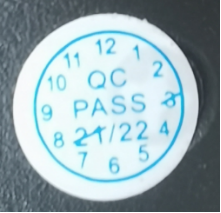

# TESmart HKE120-EH23 FAQ (transcription)

Source: https://support.tesmart.com/hc/en-us/articles/41230548979481-HKE120-EH23-FAQ
Page by "TESmart.01", "Updated December 16, 2024 05:44". Transcribed 2026-11-21, text verbatim
(spelling, punctuation and the unfinished sentence in answer 2 as on the page). Content and image
© TESmart, kept here so the statements this project relies on stay readable if the page changes.
Our reading of it: [README, "Hardware versions"](../../README.md#hardware-versions).

---

# HKE120-EH23(FAQ)

**1：What is the difference between the new version of HKE120-EH23 and the old version?**

A: The new version of HKE120-EH23 supports IGMP authentication. It is possible to utilize more TXs
for many-to-many connections on IGMP network switches, and improves the video output stability
during many-to-many connections

**2：Can the new version of RX and the old version of TX, or the new version of TX and the old
version of RX be used in combination?**

A: Since the new version of HKE120-EH23 supports IGMP authentication and the old version does not
support IGMP authentication, the new version of RX cannot receive the video signal from the old
version of TX, and the new version of TX cannot send the video signal to the old version of RX. If
you need to use them together.

1) Please contact us via the following link: “Contact us (Work Order?) URL”

2) Please contact our customer service to send back the old version of the product and we will
upgrade your old version of the product for free. The upgraded product is compatible with the new
version.

Translated with www.DeepL.com/Translator (free version)

**3：How can I tell if my HKE120-EH23 is a new version or an old version?**

A: There is a tear-proof sticker at the screw opening of the product, you can judge whether the
product is a new version or an old version by the date on the tear-proof sticker: if the factory
date is after June 2024, it is a new version; if it is before June 2024 (excluding June), it is an
old version.

The date of production indicated in the illustration is: March 2021

---

Image: https://support.tesmart.com/hc/article_attachments/41230559431577 (PNG, 221 × 213,
downloaded 2026-11-21). How to read it: the seal is a clock face of months with the two years
below; the factory marks the month and the year by striking them through, here 3 and 21, so
March 2021.
